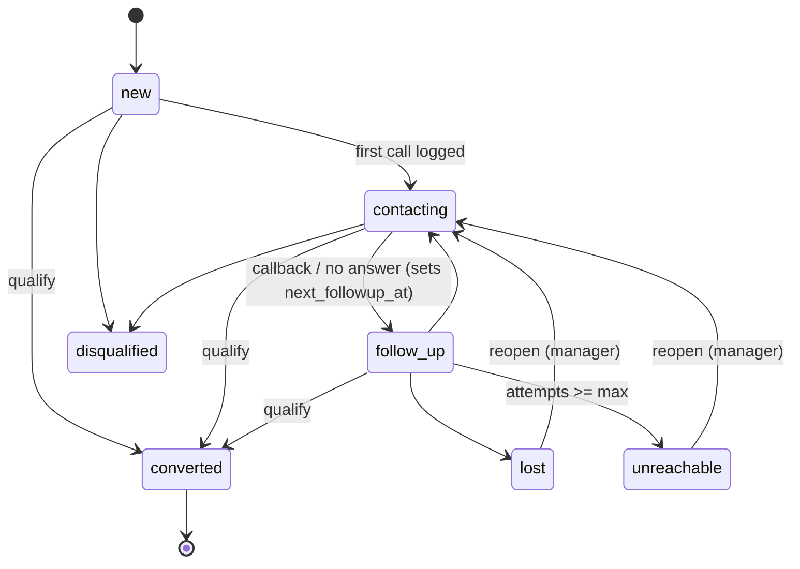
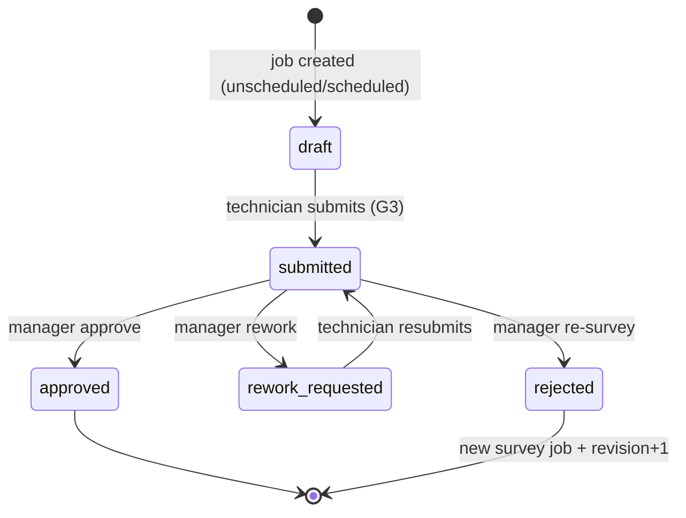
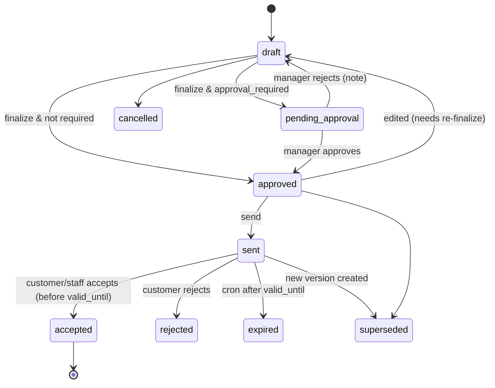
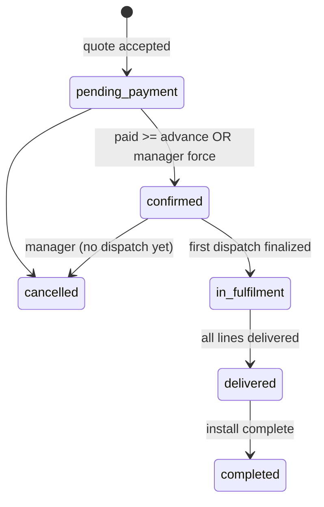
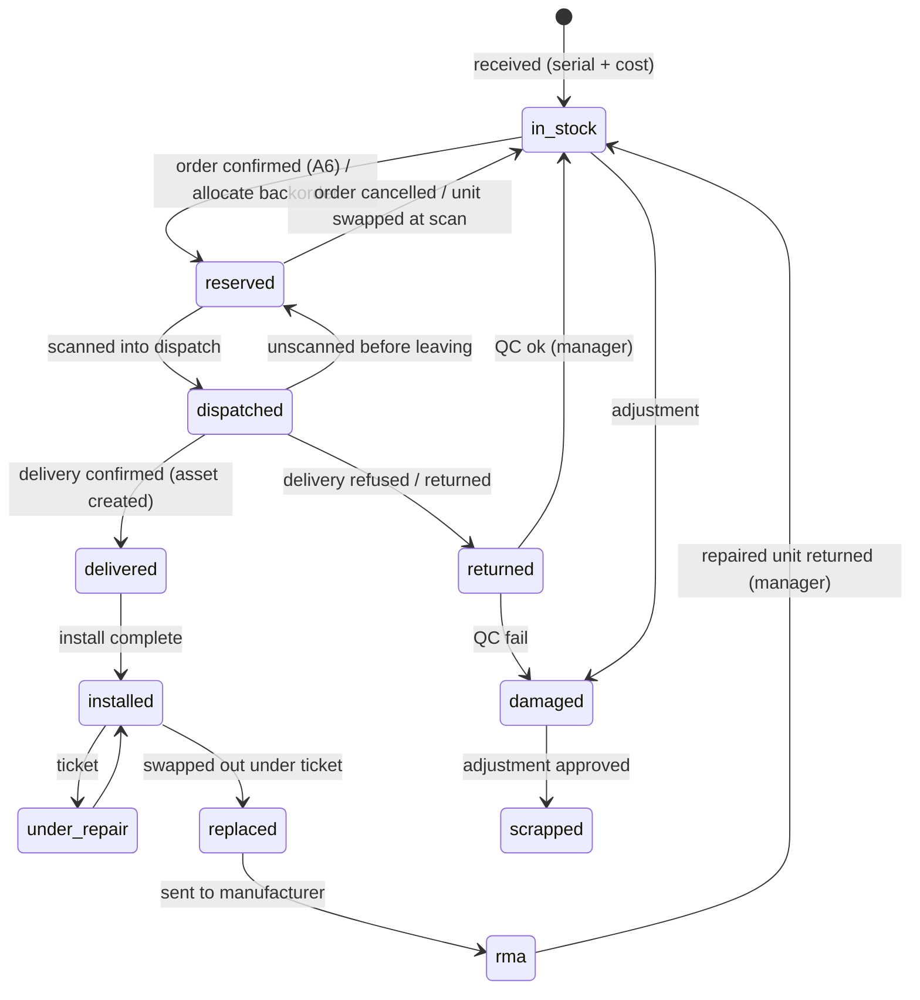
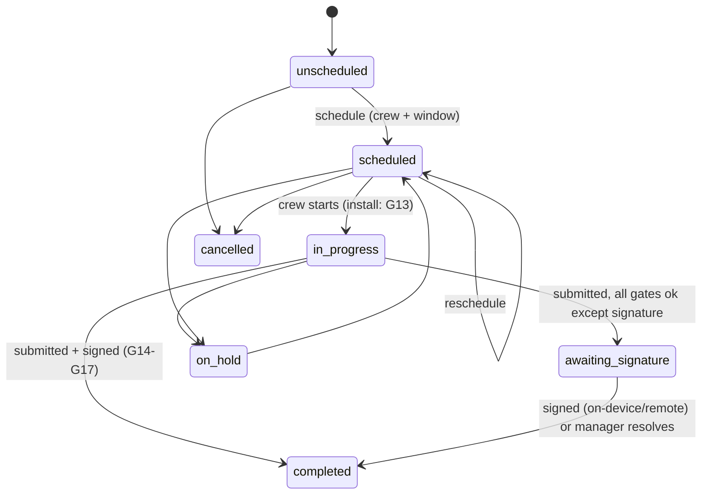
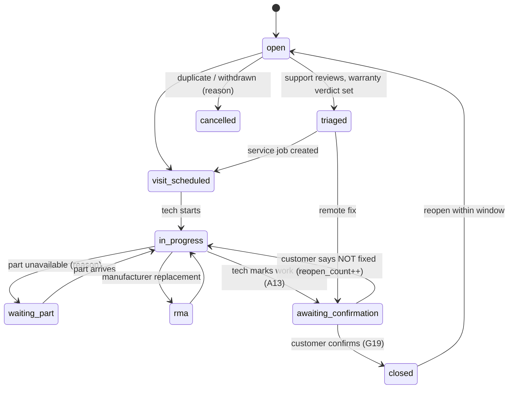

# Part 4 — Control Flow, State Machines, Gates, Automations, RPC Catalogue

> This is the **behavioural spec**. File 03 defines the data; this file defines *what moves it*. Every transition lists: who may do it, the guard (gate), the side-effects (automations). If an agent implements a transition not listed here, it is a bug.

Conventions: **G#** = gate (blocking rule). **A#** = automation (side-effect that happens without a human). **RPC** = Postgres function `fn_*` (service-role, takes `p_actor uuid`). Error codes are in file 07 §2.

---

## 1. The big picture

```mermaid
flowchart TD
  W[Public web form / manual entry] -->|A1| L[Lead: new]
  L -->|call + checklist| Q{Qualified?}
  Q -- no --> LX[Lead closed: disqualified / lost / unreachable]
  Q -- yes -->|A3| P[Project created + Survey job]
  P --> S[Surveyor submits survey]
  S --> R{Manager review}
  R -- rework --> S
  R -- re-survey --> P
  R -- unfeasible --> PX[Project cancelled]
  R -- approve --> G1[[G1: Quote unlocked]]
  G1 --> QD[Quote draft from template -> auto BOM]
  QD --> AP{Needs approval?}
  AP -- yes --> MA[Manager approves] --> QS
  AP -- no --> QS[Quote sent: link + PDF]
  QS --> QA{Customer}
  QA -- accepts --> O[Order: pending_payment]
  QA -- rejects/expires --> QX[Quote closed]
  O -->|payment >= advance| A6((A6 Order confirmed))
  A6 --> RS[Stock reserved atomically]
  A6 --> PK[Pick-list created]
  A6 --> IJ[Install job auto-scheduled]
  PK --> D[Dispatch: scan every serial]
  D --> TR[In transit]
  TR --> DL[Delivery confirmed: OTP/signature/photo]
  DL -->|A10| AS[Assets + warranty clocks start]
  AS --> IN[Install: form, photos, test]
  IN --> SG{Signature}
  SG -- signed --> DONE[Job complete]
  SG -- absent --> AW[Awaiting signature: remote link]
  SG -- refused --> DSP[Disputed - manager]
  DONE -->|A11| FIN[Invoice, subsidy checklist, profit view]
  FIN -.18 months later.-> T[Ticket]
  T --> WD{Warranty?}
  WD -- in --> FREE[Free repair]
  WD -- out --> BILL[Auto-billed parts+labour]
  FREE --> CF[Customer confirms]
  BILL --> CF
  CF --> CL[Ticket closed]
```

---

## 2. Project stage machine (customer-facing "Solar Journey")

`projects.stage` is **derived by RPCs**, never set directly from UI.

| From | To | Triggered by (RPC) | Guard | Notes |
|---|---|---|---|---|
| — | `qualified` | `fn_qualify_lead` | checklist complete | project created |
| `qualified` | `survey_scheduled` | `fn_schedule_job` (survey) | tech free (no overlap) | |
| `survey_scheduled` | `survey_submitted` | `fn_submit_survey` | G3 required fields + photos | |
| `survey_submitted` | `survey_approved` | `fn_review_survey('approve')` | manager; feasibility ≠ not_feasible | **unlocks quote (G1)** |
| `survey_submitted` | `survey_scheduled` | `fn_review_survey('resurvey')` | manager, note | new survey job (revision+1) |
| `survey_submitted` | `survey_scheduled` | `fn_review_survey('rework')` | manager, note | same job re-opened `in_progress` |
| `survey_submitted` | `cancelled` | `fn_review_survey('close_unfeasible')` | manager, reason | |
| `survey_approved` | `quoted` | `fn_send_quote` | quote `approved` | |
| `quoted` | `survey_approved` | quote rejected/expired/superseded with no live quote | | allows re-quote |
| `quoted` | `awaiting_payment` | `fn_accept_quote` / public accept | quote `sent`, not expired | order created |
| `awaiting_payment` | `order_confirmed` | A6 `fn_confirm_order` | paid ≥ advance (or force) | |
| `order_confirmed` | `dispatched` | `fn_finalize_dispatch` (all lines dispatched) | G11 | partial dispatch keeps stage |
| `dispatched` | `delivered` | `fn_confirm_delivery` (all lines delivered) | | A10 |
| `delivered` | `installed` | `fn_complete_job` (install) | G14–G17 | A11 |
| `installed` | `commissioned` | `fn_update_subsidy` → status `commissioned` **or** manual `fn_mark_commissioned` | DISCOM commissioning certificate recorded | for non-subsidy projects: manual by manager |
| `commissioned` | `completed` | `fn_complete_project` | final invoice paid (or manager override) AND subsidy ∈ {not_applicable, credited, rejected, claim_pending} | |
| any (pre-install) | `on_hold` | `fn_hold_project` | manager, reason | resume restores previous stage (stored in status_history) |
| any (pre-delivery) | `cancelled` | `fn_cancel_project` / `fn_cancel_order(close_project)` | manager, reason; no dispatched/delivered units | |

Tracker page maps stages to 8 customer-friendly steps: Enquiry received → Site survey → Quote → Order confirmed → Material dispatched → Installation → Net-metering & commissioning → Subsidy (if eligible).

---

## 3. Entity state machines

### 3.1 Lead (`lead_status`)

| Transition | Actor | Guard | Side-effects |
|---|---|---|---|
| create | public/sales/manager | phone valid E.164 | A1/A2 |
| log call | owner/manager | — | `attempt_count++` on `no_answer/busy`; `last_contacted_at`; status → `contacting`/`follow_up` |
| → `unreachable` | owner/manager | `attempt_count ≥ lead.max_contact_attempts` OR manager forces with reason | close_reason required |
| → `lost` / `disqualified` | owner/manager | reason required (picklist + free text) | notify manager if lead had a survey |
| → `converted` | `fn_qualify_lead` | G2 checklist complete | creates project (A3) |
| reopen | manager | closed < 90 days or new enquiry from same phone | status `contacting`, activity logged |
**Leads are never deleted** (no delete RPC exists).

### 3.2 Survey (`survey_status`) & survey job

- Survey **job** status: `unscheduled → scheduled → in_progress → completed` (completed at submit; re-opened to `in_progress` on rework).
- Only **one active survey job per project** (partial unique index).
- A survey is the **gate evidence**: `quotes.survey_id` references the `approved` survey.

### 3.3 Quote (`quote_status`)

Invariants: one live quote per project (draft/pending_approval/approved/sent). `accepted`, `rejected`, `expired`, `superseded`, `cancelled` are terminal. Quote lines & frozen prices are immutable after `sent`.

### 3.4 Order (`order_status`) + pay status

`pay_status`: `unpaid` (0) → `partial` (0 < paid < advance) → `advance_met` (advance ≤ paid < total) → `paid` (= total) → `overpaid` (> total). Computed by `fn_refresh_order_payment`.

### 3.5 Stock unit (serialised)

Allowed transitions are encoded in `fn_unit_transition(unit, to, actor, reason)`, a single function every RPC uses; any other transition raises `INVALID_STATE`.

### 3.6 Pick list / Dispatch
- **Pick list:** `pending` (created A6) → `picking` (first scan or pick) → `packed` (all lines complete, not yet finalised) → `dispatched` (all quantities dispatched) | `cancelled` (order cancelled). Partial dispatches keep it `picking`.
- **Dispatch:** `draft` → `loading` (first accepted scan) → `in_transit` (finalised) → `delivered` | `partially_delivered` | `returned`; `cancelled` only from `draft/loading` (all scanned units revert to `reserved`).

### 3.7 Job (`job_status`)

Install report signature sub-state: `pending → signed | refused | remote_pending`. `refused` ⇒ job stays `awaiting_signature`, flagged **Disputed** (red) until `fn_resolve_signature_dispute`.

### 3.8 Ticket (`ticket_status`)

**A ticket is never closed without customer confirmation** except `fn_close_ticket_unconfirmed` (manager, reason such as "unreachable after 3 attempts").

### 3.9 Invoice
`draft → issued → partially_paid → paid`; `draft|issued → void` (reason; blocked if payments allocated → issue credit note instead). `invoice_no` is assigned at `issued`.

### 3.10 Subsidy application (tracking only)
`not_applicable` | `registration_pending → awaiting_installation → docs_pending → inspection_pending → commissioned → claim_pending → credited` | `rejected`. `on_query` is an orthogonal flag. Forward moves need the readiness checklist for `inspection_pending` (G18). Backward moves: manager with reason.

### 3.11 Pay period
`open → locked → approved (director) → paid`.

---

## 4. Gate catalogue (blocking rules)

| ID | Gate | Enforced in | Error code | Override |
|---|---|---|---|---|
| G1 | **No quote unless the project's latest survey is `approved`** | `fn_create_quote`, `fn_revise_quote`, `fn_finalize_quote`, `fn_send_quote` (re-checked) | `SURVEY_NOT_APPROVED` | none |
| G1b | Survey not older than `survey.max_age_days` (120) | `fn_create_quote` | `SURVEY_STALE` | manager (reason) |
| G1c | Quote size ≤ survey `recommended_kw` | `fn_create_quote` | `SIZE_EXCEEDS_SURVEY` | manager approval path (reason) |
| G2 | Qualification checklist complete (area, bill or units, grid suitability, ownership, address) | `fn_qualify_lead` | `CHECKLIST_INCOMPLETE` | none |
| G3 | Survey required fields + photos (≥2 roof, ≥1 meter, ≥1 DB) | `fn_submit_survey` | `SURVEY_INCOMPLETE` / `SURVEY_PHOTOS_MISSING` | none |
| G4 | Subsidy-eligible quote must use DCR panels | `fn_build_quote_lines`, `fn_update_quote` | `DCR_REQUIRED` | manager removes `subsidy_eligible` with reason |
| G5 | Discount ≤ max% AND margin ≥ min% else manager approval | `fn_finalize_quote` | (state → `pending_approval`) | manager approves |
| G6 | Quote accept only if `sent`, link valid, `today ≤ valid_until`, quote is the live one | `fn_accept_quote*` | `QUOTE_EXPIRED` / `QUOTE_NOT_ACCEPTABLE` | resend / revise |
| G7 | Order confirms only when paid ≥ advance (or manager force + reason) | `fn_confirm_order` | `ADVANCE_NOT_MET` | manager force |
| G8 | Payment: positive amount, not future-dated, unique (method, reference), idempotent | `fn_record_payment` | `PAYMENT_*` | — |
| G9 | Reservation cannot exceed available (never negative stock) | `fn_reserve_*`, check constraints | `INSUFFICIENT_STOCK` (partial reserve + backorder flag instead of failing the order) | — |
| G10 | Dispatch blocked if `dispatch_blocked` (payment rule) | `fn_create_dispatch`, `fn_finalize_dispatch` | `DISPATCH_BLOCKED_PAYMENT` | manager (reason) |
| G11 | Finalise dispatch only if every serialised required unit scanned (or partial with reason) | `fn_finalize_dispatch` | `DISPATCH_INCOMPLETE` | partial flag + reason |
| G12 | Scan validity (known serial, right product, right order, not already dispatched, usable status) | `fn_scan_dispatch_unit` | returns `{ok:false,result}` (persisted in `scan_events`) | — |
| G13 | Install may start only if order fully delivered | `fn_start_job` | `INSTALL_BLOCKED_NOT_DELIVERED` | manager (reason) |
| G14 | Power test must pass to complete install | `fn_submit_install` | `POWER_TEST_FAILED` | — (re-test) |
| G15 | Required photo kinds present (`install.required_photo_kinds`) | `fn_submit_install` | `PHOTOS_MISSING` | — |
| G16 | Signature present (signed) to complete; else `awaiting_signature` | `fn_submit_install`/`fn_attach_signature` | (state) | manager resolves dispute with evidence |
| G17 | Installed kW ≠ quoted kW → variation required before final invoice issuance | `fn_submit_install`, `fn_issue_invoice` | `VARIATION_PENDING` | manager decides variation |
| G18 | Subsidy readiness checklist before `inspection_pending` | `fn_update_subsidy` | `SUBSIDY_NOT_READY` | manager with reason |
| G19 | Ticket close needs customer confirmation | `fn_confirm_ticket`, `fn_close_ticket*` | `CONFIRMATION_REQUIRED` | manager `unconfirmed` close |
| G20 | Cost data incomplete ⇒ profit flagged `Incomplete` | `v_project_profit.is_complete` | (display) | — |
| G21 | Technician cannot be double-booked | `fn_schedule_job`, `fn_assign_crew` | `TECH_DOUBLE_BOOKED` | manager override flag |
| G22 | Time entries cannot overlap per person; none after pay period locked | exclusion constraint, `fn_*time*` | `TIME_OVERLAP`, `PAY_PERIOD_LOCKED` | — |

---

## 5. Automation catalogue (happen inside the same transaction as their trigger)

| ID | Trigger | Automatic effects |
|---|---|---|
| A1 | Lead created (public/manual) | normalise phone → find/create customer → open-lead dedupe (A2) → **round-robin owner** (active `sales` with fewest open leads; tie → least recently assigned) → `lead_activities(created)` → notify owner (`action_required`); if no sales user → notify managers "Unassigned lead" |
| A2 | Enquiry from phone with an existing **open** lead | no new lead; append `duplicate_enquiry` activity with the new details; bump priority (`updated_at`); notify owner "Repeat enquiry from <name>"; return existing `lead_no` |
| A3 | Lead qualified | create project (+ subsidy shell, tracker link) → create survey job (+ draft survey) → if a surveyor/time supplied: schedule; else notify manager to schedule → lead `converted` |
| A4 | Survey approved | project `survey_approved`; notify sales owner "Quote unlocked — <customer>"; tracker updates |
| A5 | Quote accepted | create **order** + order lines (copy of frozen quote lines) + advance_required; project `awaiting_payment`; notify sales owner + accounts ("Collect advance ₹X") |
| A6 | Payment brings `paid ≥ advance_required` | **`fn_confirm_order`**: status `confirmed` → create **pick list** → **reserve stock** (advisory-locked per product; partial reserve + backorder flag if short) → create **install job** and **auto-schedule** (least-loaded technician, first working day ≥ today + `install.lead_days`) → draft order invoice → notify warehouse (pick-list ready), crew lead (job scheduled), manager (FYI + shortages), sales owner |
| A7 | Payment reversed/bounced after confirmation | if paid < advance: set `pick_lists.dispatch_blocked=true` (reason "advance reversed"); notify accounts + manager (`warning`); no un-reservation |
| A8 | Stock received | `fn_allocate_backorders(product_ids)` — FIFO by `orders.confirmed_at`; notify warehouse/manager of allocated shortages; low-stock re-check |
| A9 | Dispatch finalised | units already `dispatched`; **bulk `issued` movements** (on_hand − qty, reserved − qty); **cost postings** to `project_costs` (serialised: actual unit cost; bulk: current average) — idempotent by `(source_type, source_id)`; order → `in_fulfilment`; project `dispatched` if complete; create delivery share-link; auto-issue order invoice if `invoice.auto_issue_at='dispatch'`; notify sales owner, crew lead |
| A10 | Delivery confirmed | each serialised unit: status `delivered` + **asset created** with `warranty_months` snapshot from product and `warranty_start = delivery date (IST)` (if trigger=`delivery`); order lines `qty_delivered`; order `delivered`; project `delivered`; asset share-link (QR) created; notify crew lead "install can start", sales owner |
| A11 | Install job completed | assets → `installed` (+`installed_at`; set `warranty_start` if trigger=`installation`); units → `installed`; order → `completed`; project `installed`; invoice draft→(issue per gate G17); **subsidy checklist refresh** and status → `docs_pending` (if eligible); asset passport ready; notify accounts (final invoice + subsidy docs), sales owner, manager (profit now computable) |
| A12 | Ticket created | resolve asset (by serial/customer) → **warranty verdict** (`fn_compute_warranty`) stored with basis snapshot → billing flag → repeat detection (same asset within N days) → SLA due → fault-code suggestion event → assign support owner (round-robin) → notify |
| A13 | Technician marks work done | close open time entries; if billable lines exist → **auto-create + auto-issue service invoice**; ticket → `awaiting_confirmation`; notify support "Get customer confirmation"; notify accounts if invoice |
| A14 | Customer confirms | ticket `closed`; asset `installed` (if `under_repair`); notify support/manager |
| A15 | Cron | quote expiry; follow-up overdue; stale `pending_payment`; SLA breach; warranty expiring (AMC suggestion); share-link expiry; missing time entries |
| A16 | Stock movement/receipt/dispatch | if `available < reorder_level` → notify warehouse + manager once per day per product |

---

## 6. Notification matrix

`severity`: i=info, s=success, w=warning, a=action_required. Every notification has a deep link.

| Event | Recipients | Title template | Sev |
|---|---|---|---|
| Lead assigned / new | owner | "New lead: {name} · {kw} kW · {city}" | a |
| Repeat enquiry | owner | "Repeat enquiry from {name}" | i |
| Unassigned lead | managers | "Lead {lead_no} has no owner" | a |
| Follow-up overdue | owner | "Follow-up overdue: {name}" | w |
| Survey scheduled | technician(s) | "Survey {job_no} · {date} {time} · {address}" | a |
| Survey submitted | managers | "Survey ready for review: {project_no}" | a |
| Survey approved | sales owner | "Quote unlocked for {project_no}" | s |
| Survey rework/resurvey | technician | "Survey needs changes: {note}" | a |
| Quote needs approval | managers | "Quote {quote_no} needs approval: {reason}" | a |
| Quote approved/rejected | creator | "Quote {quote_no} {approved/returned}" | i |
| Quote sent | creator (confirm) | — (UI toast only) | — |
| Quote accepted | sales owner, accounts | "Accepted: {quote_no} · collect advance ₹{x}" | a |
| Quote rejected | sales owner | "Quote {quote_no} rejected: {reason}" | w |
| Quote expiring (24 h) | sales owner | "Quote {quote_no} expires tomorrow" | w |
| Payment received | sales owner, manager (if ≥ ₹1,00,000) | "₹{amt} received · {order_no}" | s |
| Order confirmed | warehouse, crew lead, sales owner, managers | "Order {order_no} confirmed — pick-list ready" / "Install {job_no} scheduled {date}" | a/i |
| Stock shortage (backorder) | managers, warehouse | "Short: {sku} ×{n} for {order_no}" | w |
| Dispatch finalised | sales owner, crew lead | "{order_no} dispatched · {vehicle}" | i |
| Delivery confirmed | crew lead, sales owner | "{order_no} delivered — install can start" | s |
| Install complete | accounts, sales owner, managers | "Install done: {project_no} · issue final invoice" | s |
| Awaiting signature >48 h | managers, sales owner | "Signature pending: {project_no}" | w |
| Signature refused | managers | "Customer refused to sign: {project_no}" | a |
| Variation pending | managers | "Variation: {project_no} {quoted}→{installed} kW" | a |
| Ticket created | support owner | "Ticket {ticket_no}: {issue} · {warranty verdict}" | a |
| Ticket repeat | managers | "Repeat complaint on {serial}" | w |
| Ticket SLA breach | support owner, managers | "SLA breached: {ticket_no}" | w |
| Work done | support owner, accounts (if invoice) | "Confirm with customer: {ticket_no}" | a |
| Low stock | warehouse, managers | "Low stock: {sku} {n} left" | w |
| Adjustment needs approval | managers | "Stock adjustment awaiting approval" | a |
| Payment reversed | accounts, managers | "Payment reversed on {order_no}" | w |
| Subsidy action due | accounts | "Subsidy: {project_no} → {next_action}" | a |
| Warranty expiring | sales (AMC lead suggestion) | "{n} warranties expiring this month" | i |

---

## 7. Key transaction pseudocode (agents: implement exactly this logic)

### 7.1 `fn_confirm_order(p_actor, p_order_id, p_force boolean default false, p_force_reason text default null)`
```
BEGIN
  SELECT * INTO o FROM orders WHERE id = p_order_id FOR UPDATE;
  IF NOT FOUND → NOT_FOUND
  IF o.status = 'confirmed' OR o.status IN ('in_fulfilment','delivered','completed') → RETURN {ok:true, already:true}
  IF o.status = 'cancelled' → ORDER_CLOSED
  PERFORM fn_refresh_order_payment(o.id);  -- recompute paid_paise (received only)
  IF o.paid_paise < o.advance_required_paise AND NOT p_force → ADVANCE_NOT_MET
  IF p_force AND (p_force_reason IS NULL OR actor role NOT manager/director) → FORBIDDEN / VALIDATION
  UPDATE orders SET status='confirmed', confirmed_at=now(), confirmed_by=p_actor,
         force_confirmed=p_force, force_reason=p_force_reason
  UPDATE projects SET stage='order_confirmed'
  -- pick list
  INSERT pick_lists (snapshot order_no, project_no, customer_name, phone, delivery_address,
                     dispatch_blocked = (setting require_full_payment_before_dispatch AND paid<total), …)
  INSERT pick_list_lines FROM order_lines WHERE product.tracks_stock
  -- reservation
  PERFORM fn_reserve_order_stock(o.id)          -- see 7.2
  -- install job (idempotent via partial unique index)
  INSERT jobs (type='install', status='unscheduled', title, estimated_hours) ON CONFLICT DO NOTHING
  IF setting job.auto_schedule THEN PERFORM fn_auto_schedule_install(job_id)  -- least-loaded technician, first working day ≥ today+install.lead_days, 09:00 IST
  -- invoice draft
  PERFORM fn_generate_order_invoice(p_actor, o.id)
  -- audit, status history, notifications (see §6)
  RETURN {ok:true, order_id, pick_list_id, job_id, shortages:[…]}
END
```

### 7.2 `fn_reserve_order_stock(p_order_id)` — atomic reservation
```
FOR line IN order_lines WHERE order_id = p_order_id AND product.tracks_stock ORDER BY product_id:  -- deterministic order avoids deadlocks
  need := line.qty - line.qty_reserved
  CONTINUE IF need <= 0
  PERFORM pg_advisory_xact_lock(hashtext('stock:' || line.product_id));   -- serialises competing orders per product
  IF product.is_serialised THEN
     UPDATE stock_units su SET status='reserved', reserved_order_id=…, reserved_order_line_id=line.id, reserved_at=now()
       WHERE su.id IN (SELECT id FROM stock_units WHERE product_id=line.product_id AND status='in_stock'
                       ORDER BY received_at, id LIMIT need)            -- FIFO
     GET DIAGNOSTICS got = ROW_COUNT
  ELSE
     UPDATE bulk_stock SET reserved = reserved + LEAST(available, need) …  RETURNING …
     INSERT stock_movements (movement='reserved', qty=got, order_id, order_line_id)
  END IF
  UPDATE order_lines SET qty_reserved = qty_reserved + got
  IF got < need THEN shortages += {sku, short: need-got} END IF
END LOOP
IF shortages not empty → UPDATE pick_lists SET notes = 'BACKORDER: …'; notify managers+warehouse (A5/§6)
```
**Concurrency test (mandatory pgTAP/Node script):** two sessions confirm two different orders each needing the last inverter at the same time → exactly one gets `qty_reserved=1`; the other has a backorder; `stock_units` has exactly one `reserved` row; no constraint violation.

### 7.3 `fn_scan_dispatch_unit(p_actor, p_dispatch_id, p_raw text, p_method text, p_idem uuid, p_line_id uuid default null)`
Returns jsonb; **never raises for scan rejections** (so that the rejection is persisted in `scan_events`). Raises only for auth/closed-dispatch.
```
IF scan_events.idempotency_key = p_idem EXISTS → RETURN stored result (idempotent)
serial := normalize(p_raw)   -- upper, trim, remove spaces; keep hyphens (see file 06 §3.2)
SELECT d, pl, o ... FOR UPDATE on dispatch
IF d.status NOT IN ('draft','loading') → RAISE 'DISPATCH_CLOSED'
IF pl.dispatch_blocked AND not overridden → RAISE 'DISPATCH_BLOCKED_PAYMENT'
candidates := stock_units WHERE serial_no = serial AND product_id IN (serialised products on this order's lines)
IF none:
    exists_elsewhere := stock_units WHERE serial_no = serial
    result := CASE WHEN exists_elsewhere THEN 'rejected_wrong_product' ELSE 'rejected_unknown' END
    → log + RETURN {ok:false, result, message}
IF >1 candidate AND p_line_id IS NULL → RETURN {ok:false, result:'rejected_other', message:'Select the item line'}
unit := the candidate (lock FOR UPDATE)
line := order_line for unit.product_id (matching p_line_id if given) WHERE qty_dispatched_or_scanned < qty
IF line IS NULL → 'rejected_other' "Required quantity already scanned for {sku}"
CASE unit.status
  WHEN 'reserved' → IF unit.reserved_order_id <> o.id → 'rejected_reserved_other' ELSE ok
  WHEN 'in_stock' → IF setting dispatch.allow_unit_swap: 
        pick one reserved-and-unscanned unit of this line, release it (status in_stock), reserve this unit (advisory lock on product) ; ok
        ELSE 'rejected_bad_status' "Not reserved for this order"
  WHEN 'dispatched','delivered','installed' → 'rejected_duplicate' (message differs if same dispatch: "Already scanned in this dispatch")
  WHEN 'damaged','rma','under_repair','scrapped','replaced','returned' → 'rejected_bad_status'
END
ON OK: INSERT dispatch_items; unit → 'dispatched'; pick_list_lines.qty_picked += 1; dispatch → 'loading'; pick_list → 'picking'
LOG scan_events (all outcomes) ; RETURN {ok:true, unit:{serial,sku}, line:{scanned,required}, remaining_total}
```

### 7.4 `fn_confirm_delivery(...)` core
```
LOCK dispatch FOR UPDATE; require status IN ('in_transit','partially_delivered')
verify method: 'otp' → hash compare with expiry+attempt limit (5) | 'signature'/'photo' → proof_path required | 'staff_override' → manager + reason
FOR each dispatch_item (not removed, not delivered):
   unit → 'delivered'
   INSERT assets (stock_unit_id, product_id, serial_no, customer_id, project_id, order_id,
                  delivered_at=now(), warranty_months = product.warranty_months,          -- SNAPSHOT
                  warranty_start = CASE trigger WHEN 'delivery' THEN (now() AT TIME ZONE 'Asia/Kolkata')::date END)
   dispatch_item.delivered_at = now(); order_lines.qty_delivered += qty
bulk items: order_lines.qty_delivered += qty
dispatch.status = delivered (or partially_delivered if other items for this dispatch were returned)
IF all order_lines.qty_delivered >= qty → order 'delivered', project 'delivered'
create asset share_links (kind 'asset') for QR labels
notify (§6)
```

---

## 8. Concurrency & integrity rules (summary)
1. **Row locks:** every RPC `SELECT … FOR UPDATE` the aggregate root (project/order/dispatch/ticket) first.
2. **Advisory locks** per product for reservation/swap (`hashtext('stock:'||product_id)`), taken in `product_id` order.
3. **Idempotency:** payment, scan, receive, dispatch-finalize, install-submit, ticket-create, time-entry, photo-attach carry client UUIDs with unique constraints; repeats return the original result.
4. **Optimistic concurrency:** `row_version` checks on user-edited aggregates (lead, quote, survey, job).
5. **Serialization failures** (`40001`) → client auto-retries once (`RETRY`).
6. **No cascading deletes** of business data; `ON DELETE CASCADE` only on child rows of drafts (quote_lines, template items, pick_list_lines).

---

## 9. Scheduling rules (jobs)
- Working day: Mon–Sat 09:00–18:00 IST (settings `schedule.work_days`, `.start`, `.end`). Sunday excluded by default.
- Job duration estimate: survey 1.5 h; install `4 + 1.5×kW` hours (cap 9 h per day; longer jobs → manager splits manually into multi-day by rescheduling); service visit 2 h.
- **Auto-schedule algorithm** (`fn_auto_schedule_install`): earliest date ≥ `today + install.lead_days (3)` (and ≥ expected delivery date if known) that is a working day; choose active technician with the fewest scheduled jobs that day who has no overlapping job; tie → fewest jobs that week; assign as `lead`; add one `helper` if setting `install.crew_size ≥ 2` choosing the next-least-loaded. If nobody is free for 14 days → leave `unscheduled` and notify managers.
- Overlap check for manual scheduling uses `tstzrange` overlap among `scheduled/in_progress` jobs for each crew member; `TECH_DOUBLE_BOOKED` lists the conflicting job_no.
- Technicians see **today / tomorrow / upcoming** tabs. A job is visible to the technician the moment they are in `job_crew`.

---

## 10. RPC catalogue (signatures, role, result)

All take `p_actor uuid` first and call `fn_assert_role`. All return `jsonb` unless stated. **Public** RPCs take `p_token text` instead and are rate-limited.

### 10.1 Leads & survey
| RPC | Roles | Inputs | Key logic / errors |
|---|---|---|---|
| `fn_create_lead_public(p_payload jsonb, p_ip_hash text)` | public | name, phone, address, requested_kw, requirement, wants_subsidy, notes, honeypot | rate-limit (`RATE_LIMITED`); A1/A2; returns `{lead_no, duplicate:boolean}` (never leaks owner) |
| `fn_create_lead(p_actor, p_payload)` | sales, manager | same + source | A1/A2 |
| `fn_log_lead_activity(p_actor, p_lead_id, p_kind, p_outcome, p_note, p_next_followup)` | owner, manager | | updates attempt_count, status; `LEAD_CLOSED` if closed |
| `fn_assign_lead(p_actor, p_lead_id, p_owner)` | manager | | `NOT_FOUND` |
| `fn_close_lead(p_actor, p_lead_id, p_status, p_reason)` | owner, manager | status ∈ lost/disqualified/unreachable | reason required |
| `fn_reopen_lead(p_actor, p_lead_id)` | manager | | |
| `fn_qualify_lead(p_actor, p_lead_id, p_checklist jsonb, p_system_type, p_requested_kw, p_survey jsonb)` | owner, manager | `p_survey` = `{technician_id?, start?, end?}` | G2; A3; returns `{project_id, project_no, survey_job_id, warnings:[area_below_requirement…]}` |
| `fn_schedule_job(p_actor, p_job_id, p_start, p_end, p_crew uuid[], p_expected_version, p_override boolean)` | manager, support(service) | | G21; sets `scheduled`; notify crew |
| `fn_assign_crew(p_actor, p_job_id, p_crew jsonb)` | manager | | G21 |
| `fn_start_job(p_actor, p_job_id, p_client_started_at, p_override_reason)` | technician(own), manager | | G13 for install; creates open time entry for actor |
| `fn_save_survey_draft(p_actor, p_job_id, p_data jsonb)` | technician(own) | | no gate; autosave target |
| `fn_submit_survey(p_actor, p_job_id, p_data jsonb, p_client_submission_id uuid)` | technician(own), manager | | G3; idempotent; notify managers |
| `fn_review_survey(p_actor, p_survey_id, p_decision text, p_note text)` | manager | approve/rework/resurvey/close_unfeasible | note required except approve; A4 |

### 10.2 Quote / order / payment
| RPC | Roles | Inputs | Key logic / errors |
|---|---|---|---|
| `fn_create_quote(p_actor, p_project_id, p_template_id, p_options jsonb)` | sales(own), manager | `{panel_product_id?, discount_paise?, notes?, size_override_reason?, stale_override_reason?}` | **G1**, G1b, G1c; builds lines; recalculates; `QUOTE_ALREADY_LIVE`, `TEMPLATE_INACTIVE`, `SYSTEM_TYPE_MISMATCH`, `SURVEY_DATA_MISSING` |
| `fn_update_quote(p_actor, p_quote_id, p_patch jsonb, p_expected_version)` | sales(own), manager | discount, notes, valid_until, panel swap, add/remove option lines, qty override (manager) | only `draft` (or `approved` → back to `draft`) else `QUOTE_NOT_EDITABLE`; G4 |
| `fn_recalculate_quote(p_quote_id)` | internal | | pricing algorithm (file 05 §5.5) |
| `fn_finalize_quote(p_actor, p_quote_id)` | sales(own), manager | | re-check G1; G5 → `pending_approval` or `approved` |
| `fn_decide_quote(p_actor, p_quote_id, p_approve boolean, p_note)` | manager | | |
| `fn_send_quote(p_actor, p_quote_id)` | sales(own), manager | | status must be `approved` (`QUOTE_NOT_APPROVED`); creates `share_links(kind='quote')`; returns `{token, url}` **once**; project `quoted` |
| `fn_revise_quote(p_actor, p_quote_id, p_keep_prices boolean)` | sales(own), manager | | new version; old → `superseded`, link revoked; not allowed if accepted |
| `fn_public_quote_view(p_token)` | public | | whitelisted JSON (file 02 §7) |
| `fn_public_accept_quote(p_token, p_name, p_ip_hash)` | public | | G6; A5; idempotent (already accepted → returns existing order) |
| `fn_public_reject_quote(p_token, p_reason)` / `fn_public_request_changes(p_token, p_message)` | public | | notifies owner |
| `fn_accept_quote_staff(p_actor, p_quote_id, p_name, p_evidence)` | sales, manager | | phone/WhatsApp acceptance; evidence required |
| `fn_record_payment(p_actor, p_order_id|p_ticket_id, p_amount_paise, p_method, p_reference, p_received_at, p_idempotency_key, p_notes, p_allow_overpay)` | accounts, manager | | G8; cheque → `pending`; A6 |
| `fn_set_payment_status(p_actor, p_payment_id, p_status, p_reason)` | accounts, manager | pending→received, →bounced/failed | A6 or A7 |
| `fn_reverse_payment(p_actor, p_payment_id, p_reason)` | manager | | A7 |
| `fn_record_refund(p_actor, p_order_id, p_amount_paise, p_method, p_reference, p_idempotency_key)` | accounts, manager | | `REFUND_EXCEEDS_PAID` |
| `fn_refresh_order_payment(p_order_id)` | internal | | recompute `paid_paise`, `pay_status`, pick-list `dispatch_blocked` |
| `fn_confirm_order(p_actor, p_order_id, p_force, p_force_reason)` | system/manager | | §7.1 |
| `fn_cancel_order(p_actor, p_order_id, p_reason, p_retained_paise, p_close_project)` | manager | | `ORDER_ALREADY_DISPATCHED`; releases reservations; cancels pick list & install job; sets `refund_due_paise = paid − retained` |

### 10.3 Inventory & dispatch
| RPC | Roles | Notes |
|---|---|---|
| `fn_receive_stock(p_actor, p_supplier_id, p_invoice_no, p_invoice_date, p_lines jsonb, p_idempotency_key)` | warehouse, manager | serial uniqueness (whole call fails with list); costs; avg cost update; A8 |
| `fn_request_adjustment(p_actor, p_product_id, p_unit_id, p_direction, p_qty, p_reason_code, p_note, p_idempotency_key)` | warehouse, manager | auto-apply if below threshold else `pending` (`ADJUSTMENT_NEEDS_APPROVAL` info) |
| `fn_decide_adjustment(p_actor, p_adjustment_id, p_approve, p_note)` | manager | cannot push bulk `on_hand` below `reserved` (`ADJUST_BELOW_RESERVED`) |
| `fn_qc_returned_unit(p_actor, p_unit_id, p_result, p_note)` | warehouse, manager | returned → in_stock/damaged |
| `fn_reserve_order_stock(p_order_id)` / `fn_allocate_backorders(p_product_ids)` | internal | §7.2 |
| `fn_pick_bulk(p_actor, p_pick_line_id, p_qty)` | warehouse | confirms bulk picked qty (≤ reserved) |
| `fn_create_dispatch(p_actor, p_pick_list_id, p_vehicle, p_driver, p_driver_phone, p_override_reason)` | warehouse, manager | G10; one open dispatch per pick list |
| `fn_scan_dispatch_unit(...)` | warehouse, manager | §7.3 |
| `fn_unscan_dispatch_unit(p_actor, p_item_id, p_reason)` | warehouse, manager | only in `draft/loading`; unit → `reserved` |
| `fn_finalize_dispatch(p_actor, p_dispatch_id, p_partial, p_partial_reason, p_idempotency_key)` | warehouse, manager | G10, G11; A9 |
| `fn_public_delivery_view(p_token)` / `fn_public_delivery_reveal_otp(p_token)` | public | OTP valid 15 min; hash stored; ≤5 attempts |
| `fn_confirm_delivery(p_actor, p_dispatch_id, p_method, p_otp, p_proof_path, p_name, p_override_reason)` | warehouse, technician(own), manager | §7.4; A10; `DELIVERY_OTP_INVALID/EXPIRED/LOCKED` |
| `fn_return_dispatch(p_actor, p_dispatch_id, p_reason, p_item_ids)` | warehouse, manager | units → `returned`; reservation dropped; order reallocates later |

### 10.4 Field
| RPC | Roles | Notes |
|---|---|---|
| `fn_attach_job_photo(p_actor, p_job_id, p_kind, p_bucket, p_path, p_taken_at, p_lat, p_lng, p_client_photo_id)` | technician(own), manager | idempotent; verifies path prefix matches project/job |
| `fn_save_install_draft(p_actor, p_job_id, p_data)` | technician(own) | autosave |
| `fn_submit_install(p_actor, p_job_id, p_payload jsonb, p_client_submission_id)` | technician(own), manager | G14–G17; computes variation; closes time entries; may complete job; returns `{status:'completed'|'awaiting_signature'|'in_progress', missing:[…]}` |
| `fn_attach_signature(p_actor|p_token, p_job_id, p_path, p_name, p_method, p_ip_hash)` | technician(own), public(token) | completes job if all other gates already satisfied |
| `fn_refuse_signature(p_actor|p_token, p_job_id, p_reason)` | technician, public | flags dispute |
| `fn_resolve_signature_dispute(p_actor, p_job_id, p_resolution, p_note)` | manager | `accept_without_signature` (note + evidence required) or `rework` |
| `fn_add_time_entry(p_actor, p_job_id, p_profile_id, p_started, p_ended, p_client_entry_id)` / `fn_stop_time_entry(...)` | technician(own), manager | exclusion constraint → `TIME_OVERLAP` |
| `fn_complete_job(p_actor, p_job_id)` | internal | A11 |
| `fn_decide_variation(p_actor, p_variation_id, p_approve, p_note)` | manager | creates variation invoice on approve |

### 10.5 Service
| RPC | Roles | Notes |
|---|---|---|
| `fn_search_support(p_actor, p_q)` | support, manager, sales | file 06 §7 |
| `fn_compute_warranty(p_asset_id, p_at timestamptz)` | internal/support | returns `{status, warranty_start, warranty_end, days_left, rule}` |
| `fn_create_ticket(p_actor, p_payload, p_idempotency_key)` | support, sales, manager | A12 |
| `fn_public_create_ticket(p_token, p_payload, p_ip_hash)` | public (asset QR) | creates `channel='qr'` ticket for that asset's customer; rate-limited |
| `fn_update_ticket(p_actor, p_ticket_id, p_patch, p_expected_version)` | support, manager | status changes only along §3.8 |
| `fn_decide_warranty(p_actor, p_ticket_id, p_decision, p_reason)` | manager | override; `INVOICE_ALREADY_ISSUED` if billed lines issued |
| `fn_schedule_service_visit(p_actor, p_ticket_id, p_start, p_end, p_crew)` | support, manager | creates `service` job |
| `fn_add_ticket_part(p_actor, p_ticket_id, p_product_id, p_qty, p_old_asset_id, p_new_serial)` | technician(own visit), support, manager | decides `billable` from warranty decision; consumes stock; creates new asset with replacement warranty policy; posts `project_costs(service_part)`; `PART_OUT_OF_STOCK`, `REPLACEMENT_SERIAL_INVALID` |
| `fn_add_ticket_labour(p_actor, p_ticket_id, p_minutes, p_note)` | technician, support | billing rate frozen from settings |
| `fn_mark_work_done(p_actor, p_ticket_id, p_note)` | technician(own), support | A13 |
| `fn_confirm_ticket(p_actor|p_token, p_ticket_id, p_method, p_note)` / `fn_reject_fix(...)` | support, public(asset link) | A14 / back to `in_progress` |
| `fn_close_ticket_unconfirmed(p_actor, p_ticket_id, p_reason)` | manager | |
| `fn_reopen_ticket(p_actor, p_ticket_id, p_reason)` | support, manager | within window |
| `fn_transfer_asset(p_actor, p_asset_id, p_to_customer_id, p_reason)` | support, manager | history row; warranty unchanged |

### 10.6 Finance
| RPC | Roles | Notes |
|---|---|---|
| `fn_generate_order_invoice(p_actor, p_order_id)` | accounts, manager, system | one draft per order; idempotent |
| `fn_issue_invoice(p_actor, p_invoice_id, p_due_date)` | accounts, manager, system | G17; numbering; FIFO payment allocation |
| `fn_void_invoice(p_actor, p_invoice_id, p_reason)` / `fn_create_credit_note(...)` | manager | `INVOICE_HAS_PAYMENTS` |
| `fn_add_project_cost(p_actor, p_project_id, p_kind, p_amount_paise, p_note, p_job_id)` | accounts, manager | travel/permit/other |
| `fn_refresh_subsidy_checklist(p_project_id)` / `fn_update_subsidy(p_actor, p_project_id, p_patch)` | accounts, manager | G18 |
| `fn_build_pay_period(p_actor, p_label, p_from, p_to)` / `fn_adjust_pay_entry` / `fn_lock_pay_period` / `fn_approve_pay_period` (director) / `fn_mark_pay_paid` | accounts / director | file 06 §9 |
| `fn_approve_time_entries(p_actor, p_ids)` | manager | |
| `fn_create_share_link(p_actor, p_kind, p_entity_id, p_params, p_expires_at, p_redact_pii)` / `fn_revoke_share_link` | manager | returns raw token once |
| `fn_public_report(p_token)`, `fn_public_tracker(p_token)`, `fn_public_asset(p_token)` | public | whitelisted |
| `fn_dashboard(p_actor, p_range, p_from, p_to)` | manager, accounts, director | file 06 §10 |

### 10.7 Platform/admin
`fn_set_user_role`, `fn_set_user_active`, `fn_upsert_setting` (director), `fn_upsert_product`, `fn_upsert_template` (manager; price changes audited), `fn_mark_notifications_read`, `fn_rate_limit`, `fn_expire_quotes`, `fn_notify_overdue_followups`, `fn_notify_stale_orders`, `fn_notify_expiring_warranties`, `fn_flag_sla_breaches`, `fn_expire_share_links`, `fn_flag_missing_time_entries`.
